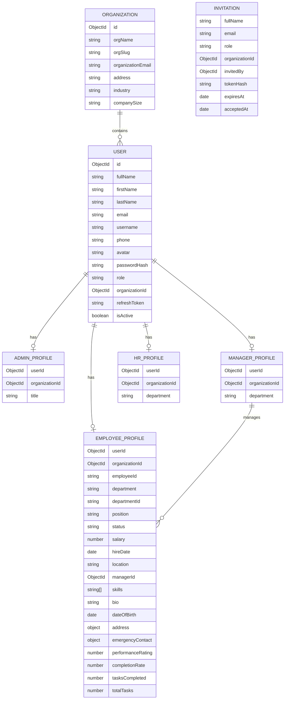

# Backend Data Model Architecture

## Model folders

```text
src/models/
  auth/
    user.model.js        # Credentials, canonical role, organization, refresh token
    otp.model.js         # One-time codes
    invitation.model.js  # Organization invitations and token state
  organization/
    organization.model.js
  roles/
    admin.model.js
    manager.model.js
    hr.model.js
    employee.model.js
```

The old flat model files remain as re-exports during this refactor. New backend code should import models from the domain folders above.

## Ownership and relationships



## Responsibilities

- `Organization` owns organization-wide information and unique slug/name constraints. Its `orgName`, `orgSlug`, `org_avatar`, and `org_CoverImage` keys match the current frontend signup naming; the controller generates `orgSlug` when omitted.
- `User` is the single authentication identity. It owns globally unique email, password hash, role, active status, organization reference, and refresh-token state.
- `Admin`, `Manager`, `HR`, and `Employee` are profile collections. Each profile has a unique `user` reference and an organization reference. Do not store a second password or email in role profiles.
- `Employee` stores the fields from the frontend employee types/form; shared identity fields (`firstName`, `lastName`, `fullName`, `email`, `phoneNumber`, `avatar`) live in `User`.
- `Invitation` stores the admin-sent name/email/role plus organization, inviter, hashed token, expiry, and acceptance time. The invitee's password is set on `User` only after acceptance.
- Role values are canonical lowercase strings: `admin`, `manager`, `hr`, `employee`. The login endpoint checks the requested role against `User.role` and returns that canonical role.
- Login and `/auth/me` query only `User`. Role-specific routes and future CRUD controllers query the corresponding profile model.

## Why not separate credential collections?

Keeping credentials in separate Admin/Manager/HR/Employee collections duplicates password hashing, unique-email enforcement, token storage, and login queries. The profile collections are separate for role-specific management, while the shared `User` collection keeps authentication consistent. An organization-specific role is currently stored on `User`; if accounts later need different roles across multiple organizations, add an `OrganizationMembership` model and move role to that membership rather than adding more credential models.
