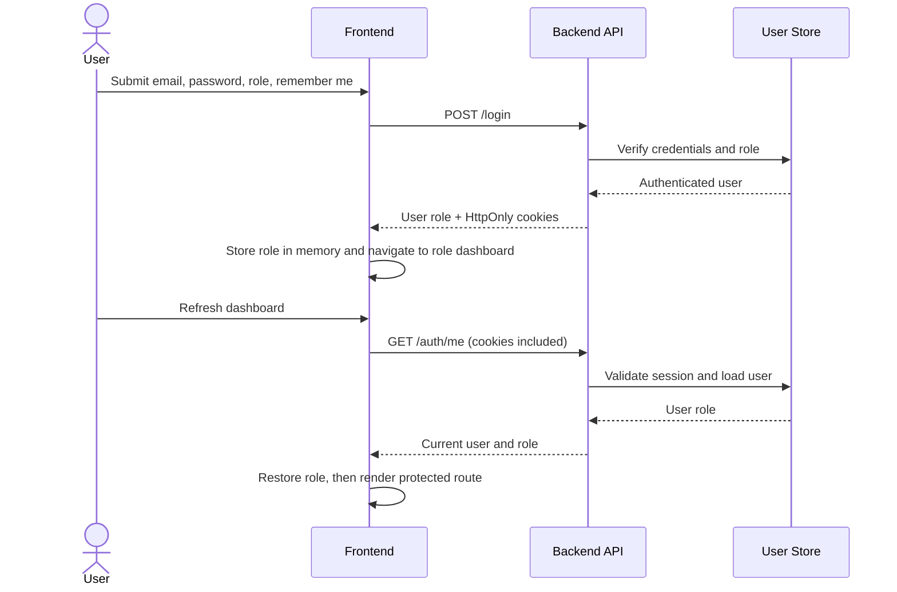

# Auth, Recovery, and Invite Contract

Frontend implementation: 2026-10-15. Backend was not changed in this work.

## Frontend and backend comparison

| Flow              | Frontend now sends/expects                                                                                             | Backend work needed                                                                                                                                                                                                                                           |
| ----------------- | ---------------------------------------------------------------------------------------------------------------------- | ------------------------------------------------------------------------------------------------------------------------------------------------------------------------------------------------------------------------------------------------------------- |
| Login             | `POST /login` with `{ email, password, role, rememberMe }`; expects `data.user[0].role` and an HttpOnly session cookie | Accept these fields, verify the password and selected role, set secure HttpOnly cookies, and use `rememberMe` to select cookie lifetime. Return the authenticated user's role in the documented response shape.                                               |
| Restore session   | `GET /auth/me` with cookies; expects `data.user[0].role`                                                               | Add a route that validates the access cookie (and refreshes it if appropriate), looks up the user, and returns their role. Return `401` when no valid session exists.                                                                                         |
| Forgot password   | `POST /auth/forgot-password` with `{ email }`                                                                          | Create a short-lived OTP, associate it with the account, send it to that email, and return a generic success response so account existence is not disclosed.                                                                                                  |
| Verify OTP        | `POST /auth/verify-otp` with `{ email, otp }`; expects `data.resetToken`                                               | Verify the submitted code against a hashed, unexpired, unused OTP. Return a short-lived, single-use reset token (or set an HttpOnly reset cookie).                                                                                                            |
| Reset password    | `POST /auth/reset-password` with `{ email, resetToken, password }`                                                     | Validate and consume the reset token, hash the new password, invalidate outstanding recovery tokens, and return a success response.                                                                                                                           |
| Create invitation | `POST /employees/invite` with `{ fullName, email, role }`                                                              | Require an authenticated organization admin, associate the invitation with that admin's organization, validate email/role, create a short-lived single-use invite token, and email a link to `/accept-invite?token=...`. Do not set an employee password yet. |
| Load invitation   | `GET /employees/invitations/:token`; expects `data.invitation` with `{ fullName, email, role, expiresAt }`             | Validate token state and expiry; return only the preassigned identity and role. Reject unknown, expired, or already-used tokens.                                                                                                                              |
| Accept invitation | `POST /employees/accept-invite` with `{ token, password }`                                                             | Validate and consume the invitation, associate the employee with the organization, hash the new password, activate the account, and return success. Never log or return the plaintext password.                                                               |

All endpoints use the existing frontend API base URL: `/api/v1/ems`. Enable credentialed CORS for the frontend origin and set cookie options appropriate for the deployed origin (`HttpOnly`, `Secure` in production, and a compatible `SameSite` policy). The frontend Axios client sends cookies with `withCredentials: true`.

## Cookie refresh flow

## Recovery and invite flow

```mermaid
flowchart LR
  Login[Login page] --> Forgot[Forgot password]
  Forgot -->|email| SendOTP[POST /auth/forgot-password]
  SendOTP --> OTP[Enter 6-digit OTP]
  OTP -->|email + code| Verify[POST /auth/verify-otp]
  Verify -->|short-lived reset token| Reset[Choose new password]
  Reset -->|email + token + password| Update[POST /auth/reset-password]
  Update --> Login

  Admin[Admin employees] --> Invite[Enter employee name, email, role]
  Invite -->|name + email + role| Create[POST /employees/invite]
  Create -->|email invite link with token| Employee[Employee opens accept link]
  Employee --> Load[GET /employees/invitations/:token]
  Load --> SetPassword[Employee creates password]
  SetPassword -->|token + password| Accept[POST /employees/accept-invite]
  Accept --> Login[Login with invited email]
```

## Notes

- `rememberMe` is sent by the frontend; persistence is implemented by the backend cookie expiry policy.
- The OTP page keeps the reset token in router state between verification and reset. If the user refreshes that page, they need to request and verify a new code unless the backend uses an HttpOnly reset cookie.
- The admin invite UI sends only name, email, and the admin-selected role. The invited employee sets and confirms their own password on `/accept-invite`.
- After a successful invite acceptance, the frontend navigates to login and pre-fills the invitation email and admin-assigned role.
- The frontend error screen is `/error`; unmatched URLs also render it.
- The existing backend OTP handler currently uses a fixed recipient and does not implement the recovery routes in this table. Update it to deliver to the requested account email when implementing this contract.
