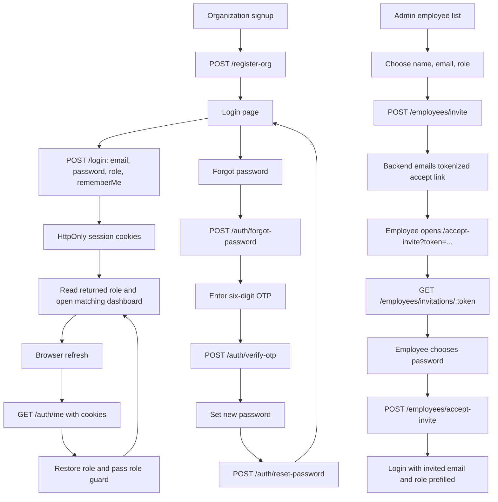

# Frontend API and Flow Contract

**Audience:** Backend implementation and integration review  
**Frontend source of truth:** `frontend/src/lib/api/auth.service.ts`, `frontend/src/types.ts`, and the auth/invite pages  
**Scope:** Describes what the frontend sends, reads, and navigates to. No backend implementation is included here.

## Base URL and response conventions

The frontend API client currently uses `http://localhost:8000/api/v1/ems` and sends requests with `withCredentials: true`. The examples below omit that base path.

For JSON responses, use this envelope consistently:

```json
{
  "statusCode": 200,
  "data": {},
  "message": "Request completed"
}
```

For errors, return an appropriate HTTP 4xx/5xx status and a readable message. The frontend error helper looks first at `response.data.message`:

```json
{
  "statusCode": 400,
  "data": null,
  "message": "The invitation has expired"
}
```

Validation may include a `data.errors` object, but `message` must still be present because current forms display that field as the fallback API error.

## Endpoint contracts

### 1. Organization signup

**Request:** `POST /register-org`, `multipart/form-data`  
**Frontend caller:** `registerUser` from `auth.service.ts`

Current multipart keys:

| Key | Value |
|---|---|
| `fullName` | Admin's full name |
| `email` | Admin email, trimmed and lowercase |
| `password` | Admin password |
| `confirmPassword` | Confirmation; frontend currently includes it in the payload |
| `avatar` | Admin profile image |
| `orgName` | Organization name |
| `address` | Organization address |
| `industry` | Selected industry |
| `companySize` | Selected size label, currently a string such as `1–10` |
| `org_avatar` | Organization avatar image |
| `org_CoverImage` | Organization cover image; exact casing follows the current frontend type/schema |

**Success response:** Any 2xx response currently counts as success at the service layer. A consistent envelope is recommended:

```json
{
  "statusCode": 201,
  "data": { "user": { "id": "...", "email": "...", "role": "admin" } },
  "message": "Organization created"
}
```

**Frontend follow-up:** `FinalSingup` currently does not navigate or display mutation success/error state. A success response alone will not complete the user journey until that UI is wired.

### 2. Login

**Request:** `POST /login`, JSON

```json
{
  "email": "employee@example.com",
  "password": "user-entered-password",
  "role": "employee",
  "rememberMe": true
}
```

**Success response the frontend reads:** `data.user[0].role`. Return the user's actual role, not the requested role, and set the session cookies in the response headers.

```json
{
  "statusCode": 200,
  "data": {
    "user": [
      {
        "id": "user-id",
        "email": "employee@example.com",
        "fullName": "Taylor Lee",
        "role": "Employee"
      }
    ]
  },
  "message": "Login successful"
}
```

The frontend trims/lowercases email, includes the role selected on the login form, and sends `rememberMe`. It normalizes the returned role to lowercase and routes by that value. Supported roles are `admin`, `employee`, `manager`, and `hr`.

The browser must not need to read access or refresh tokens from JavaScript. Use HttpOnly cookies. `rememberMe` should determine persistent cookie expiry; without it, use a session cookie.

### 3. Restore a session after refresh

**Request:** `GET /auth/me`, cookies included. The frontend calls this before rendering protected routes when its in-memory Zustand role is empty.

**Success response:** Use the same user/role response shape as login:

```json
{
  "statusCode": 200,
  "data": {
    "user": [
      { "id": "user-id", "email": "employee@example.com", "role": "Employee" }
    ]
  },
  "message": "Session restored"
}
```

Return `401` with the standard error envelope when no valid cookie session exists. The frontend then clears its in-memory role and redirects protected pages to `/login`.

### 4. Request a password-reset OTP

**Request:** `POST /auth/forgot-password`, JSON

```json
{ "email": "employee@example.com" }
```

**Success response:** Return a generic 2xx response whether or not the address exists, to avoid account enumeration:

```json
{
  "statusCode": 200,
  "data": null,
  "message": "If that account exists, a verification code has been sent"
}
```

The frontend navigates to `/verify-otp?email=employee%40example.com` after any 2xx response.

### 5. Verify the OTP

**Request:** `POST /auth/verify-otp`, JSON

```json
{ "email": "employee@example.com", "otp": "123456" }
```

The OTP input accepts exactly six digits. The frontend requires this success shape and uses the reset token in the next step:

```json
{
  "statusCode": 200,
  "data": { "resetToken": "short-lived-single-use-token" },
  "message": "Code verified"
}
```

Reject invalid, expired, already-used, or mismatched codes with a 4xx response and a useful `message`. The code should be one-time and short-lived. The reset token is held in router state, not the URL; refreshing the reset page requires restarting verification unless the backend sets an HttpOnly reset cookie.

### 6. Reset the password

**Request:** `POST /auth/reset-password`, JSON

```json
{
  "email": "employee@example.com",
  "resetToken": "short-lived-single-use-token",
  "password": "new-password"
}
```

The frontend checks that the password is at least eight characters and that confirmation matches. Confirmation is not sent. On any 2xx response, it navigates to `/login?passwordReset=success`.

```json
{
  "statusCode": 200,
  "data": null,
  "message": "Password updated"
}
```

The backend must hash the new password, consume the token, and reject expired or reused tokens.

### 7. Create an employee invitation

**Request:** `POST /employees/invite`, JSON

```json
{
  "fullName": "Taylor Lee",
  "email": "taylor@example.com",
  "role": "employee"
}
```

The admin chooses the role. The frontend invite form offers `employee`, `manager`, or `hr`; it does not collect a password. This endpoint must require an authenticated organization admin, associate the invite with that admin's organization, create an expiring single-use token, and email a link such as:

```text
https://<frontend-origin>/accept-invite?token=<opaque-token>
```

The frontend only uses the HTTP success/failure state for this response. A recommended success envelope is:

```json
{
  "statusCode": 201,
  "data": { "invitationId": "invite-id", "expiresAt": "2026-10-16T12:00:00Z" },
  "message": "Invitation sent"
}
```

### 8. Load invitation details

**Request:** `GET /employees/invitations/:token`

**Success response the frontend reads:** `data.invitation` with the admin-assigned name, email, role, and optional expiry. Do not return a password or internal token hash.

```json
{
  "statusCode": 200,
  "data": {
    "invitation": {
      "fullName": "Taylor Lee",
      "email": "taylor@example.com",
      "role": "employee",
      "expiresAt": "2026-10-16T12:00:00Z"
    }
  },
  "message": "Invitation is valid"
}
```

Invalid, expired, or consumed tokens should return 4xx with a `message`; the frontend displays its invalid/expired invitation screen.

### 9. Accept an invitation and set a password

**Request:** `POST /employees/accept-invite`, JSON

```json
{
  "token": "opaque-invitation-token",
  "password": "employee-chosen-password"
}
```

The frontend password page confirms the password locally; `confirmPassword` is not sent. On success, the frontend navigates to login with the invite email and assigned role prefilled.

```json
{
  "statusCode": 200,
  "data": null,
  "message": "Invitation accepted"
}
```

The backend should consume the invitation token, hash the password, activate/create the employee in the invited organization with the originally assigned role, and never trust a role supplied by the accept page.

## Browser cookie requirements

- Frontend Axios uses `withCredentials: true`.
- Backend CORS must allow the exact frontend origin and credentials; `Access-Control-Allow-Origin: *` is incompatible with credentialed requests.
- Set cookies as `HttpOnly`; use `Secure` in production and a compatible `SameSite` policy.
- Use a consistent hostname in local development. `localhost` and `127.0.0.1` are different cookie hosts/sites.
- Do not return secrets in JSON. The frontend obtains the role through login or `/auth/me`.

## Frontend route map

| Browser route | Screen / behavior |
|---|---|
| `/` and `/login` | Login. After invitation acceptance, the URL may include `invitation=accepted`, `email`, and `role` to show confirmation and prefill the form. |
| `/forgot-password` | Collect email and request a reset OTP. |
| `/verify-otp?email=...` | Collect the six-digit OTP and verify it. |
| `/reset-password` | Set the new password using the short-lived reset token held in router state. |
| `/accept-invite?token=...` | Load invitation details, show assigned email/role, and collect the employee-created password. |
| `/error?message=...` and unknown paths | Generic error screen with a login link. |
| `/DashBoard/Dashbord` | Admin dashboard; admin role required. |
| `/DashBoard/EmployeeDashboard` | Employee dashboard; employee role required. |
| `/DashBoard/ManagerDashboard` | Manager dashboard; manager role required. |
| `/DashBoard/HRDashboard` | HR dashboard; HR role required. |

All dashboard routes are behind the frontend session restore/role guards. When `/auth/me` returns `401`, the frontend redirects to `/login`.

## Full user journeys



## Current frontend gaps and known mismatches

1. `FinalSingup` currently does not present registration mutation success/error or navigate after success; signup completion needs UI handling.
2. Signup sends `companySize` as labels like `1–10`; the backend must normalize/validate this against its stored representation.
3. Keep the organization cover-image key exactly `org_CoverImage` for the current frontend form/type, or change both sides together.
4. The signup payload currently has no `phoneNumber`, `organizationEmail`, `username`, or `orgSlug`; the backend's organization registration handler has expected these fields. Align the signup form/type and backend contract before treating registration as integrated.
5. Recovery and invite endpoints above are the frontend's expected contract; the existing backend OTP handler is not equivalent and currently uses a fixed recipient.
6. The frontend invite page obtains invite identity/role from the token lookup response; those values must come from the stored invitation, not from user-editable acceptance fields.